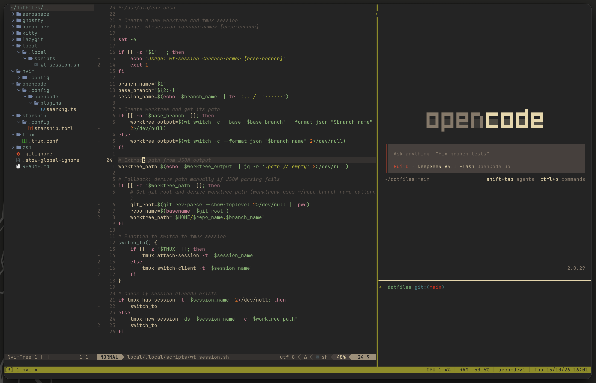

# dotfiles

My personal dotfiles.

> dotfiles: configuration files that are used to customize and personalize your system.



# Tools

- [Aerospace](https://aerospace.dev/) as the tiling window manager (MacOS).
- [Ghostty](https://ghostty.org/) as the terminal emulator.
- [Zsh](https://www.zsh.org/) as the shell.
- [GNU Stow](https://www.gnu.org/software/stow/) to manage the dotfiles symlinks.
- [Neovim](https://neovim.io/) as the main text editor.
- [tmux](https://github.com/tmux/tmux/wiki) as the terminal multiplexer.
- [lazygit](https://github.com/jesseduffield/lazygit) as terminal UI for git commands.

# Installation

Clone the repository into your home directory. Then enter the directory.

```bash
git clone <repository-url> "$HOME/dotfiles"
cd "$HOME/dotfiles"
```

Make sure that the preview lists the packages that you want. The `-n` flag prints the result and makes no change.

```bash
stow -n -v aerospace ghostty karabiner kitty lazygit nvim starship tmux zsh
```

Run `stow` with the package names to install them. Pass all the names to install every package. Pass a few names to install only those packages.

```bash
stow zsh tmux nvim
```

## Stow Packages

Each managed tool is its own GNU Stow package. A package is a directory that copies the layout of your home directory. The path of a file in the package is the path where that file belongs under `$HOME`:

```text
aerospace/.config/aerospace/
ghostty/.config/ghostty/
karabiner/.config/karabiner/
kitty/.config/kitty/
lazygit/.config/lazygit/
nvim/.config/nvim/
starship/.config/starship.toml
tmux/.tmux.conf
zsh/.zshrc
```

Stow does not symlink the whole `~/.config` directory. For each managed file, Stow makes one symlink inside `~/.config`. The directory stays normal, so the Stow symlinks and your own files live together.

To remove a symlink, run `stow -D` with the package name:

```bash
stow -D ghostty
```
